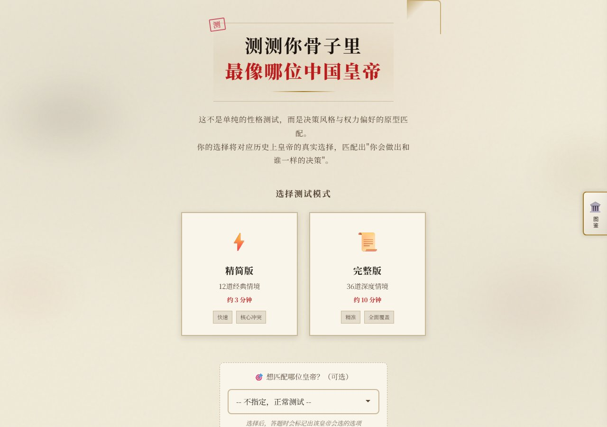
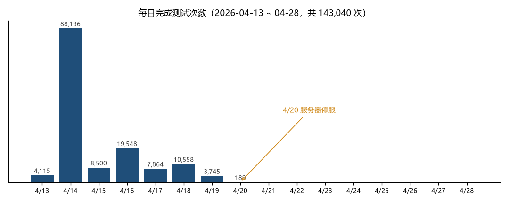

# 测测你骨子里最像哪位中国皇帝

一个历史人格测试网页游戏：回答一组皇帝视角的情境题，看看你的决策风格和哪位中国皇帝最接近。

**上线 16 天，累计完成测试 143,040 次，上线第 2 天单日 88,196 次。** 独立完成策划、题目设计、开发和运营。



## 玩法

- **两种模式**：精简版 12 题，约 3 分钟；完整版 36 题，约 10 分钟。
- **一生三个阶段**：题目按少年（8 题）、壮年（20 题）、老年（8 题）展开，从「年幼登基、大权旁落」一路走到晚年传位。
- **50 位皇帝，8 种类型**：开国之君、盛世明君、铁血霸主、守成之主、改革先锋、文艺帝王、悲剧人物、奇葩君主。
- **结果页**：展示最像的皇帝、相似度、前三名、你的关键选择和历史上他的选择对照，以及「全站有多少人和你测出同一位皇帝」。
- **收集要素**：测出的皇帝会解锁到图鉴里，附徽章和收集进度，鼓励玩家换一种答法再测。

## 数据

数据来自自建的作答记录表（每完成一次测试写入一条：结果、模式、用时、每题答案），时间范围 2026-04-13 至 04-28。



| 指标 | 数值 |
|---|---|
| 累计完成测试 | 143,040 次 |
| 单日峰值 | 88,196 次（4 月 14 日，上线第 2 天） |
| 完整版占比 | 63%（89,624 次） |
| 作答时长中位数 | 4 分钟 |

说明：统计口径是**完成次数**，不是独立用户数。记录里没有用户标识，无法去重。

## 复盘

**1. 停服导致流量断崖。** 前端部署在一台按流量计费的服务器上，费用太高，我在 4 月 20 日停了服，日完成量从 3,745 掉到 189。这类纯前端页面完全可以放在 GitHub Pages、Vercel 或 Cloudflare Pages 这类免费静态托管上，只把写入记录交给轻量后端。教训是：上线前就要算清楚流量成本，并想好流量来了以后怎么承接、怎么变现。

**2. 结果分布太集中。** 35.2% 的完成结果都是汉武帝，第二名隋文帝只有 8.6%。人格测试的乐趣在于「我测出来的和朋友不一样」，一个结果占三分之一会削弱新鲜感和分享意愿。可能的原因有两个，还没有验证：
- 汉武帝的答案向量比较「居中」，在欧氏距离匹配下天然容易成为最近邻；
- 首页的「想匹配哪位皇帝？」功能会提示目标皇帝的选项，玩家可能集中选了热门皇帝。

下一步可以用已有的逐题答案数据重新校准每位皇帝的答案向量，让结果分布更均衡，并给「指定皇帝」模式单独打标，和正常测试分开统计。

## 实现

| 部分 | 做法 |
|---|---|
| 前端 | 原生 HTML / CSS / JavaScript，无框架 |
| 匹配算法 | 每位皇帝在 36 道题上各有一个 0–3 分的答案向量，与玩家答案计算欧氏距离，换算成相似度 |
| 数据记录 | Supabase：完成测试时写入一条记录，结果页查询「同一位皇帝的人数占比」 |
| 埋点 | Google Analytics 4 |
| 素材 | `fetch_wiki.py` 等脚本从维基百科批量获取皇帝画像 |

## 本地运行

无需构建，直接用浏览器打开 `emperor_test/index.html` 即可游玩。不配置 Supabase 也能正常测试，只是结果页不会显示全站统计。

## 文件结构

```
emperor_test/
├── index.html        页面结构
├── style.css         水墨风格样式
├── data.js           题库（36 题）与 50 位皇帝的数据和答案向量
├── script.js         游戏流程、匹配算法、图鉴、数据记录
├── assets/           皇帝画像
└── fetch_*.py        画像抓取脚本
```
